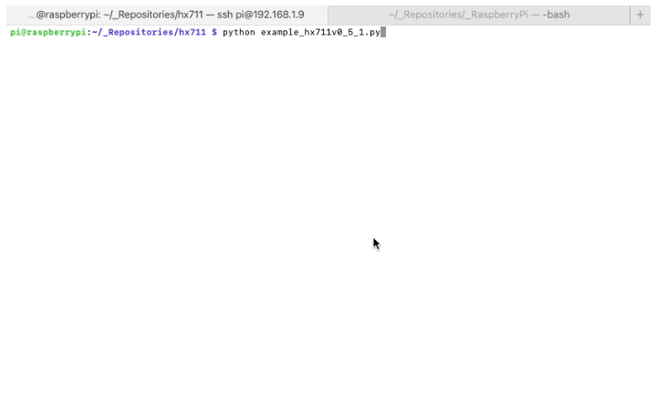
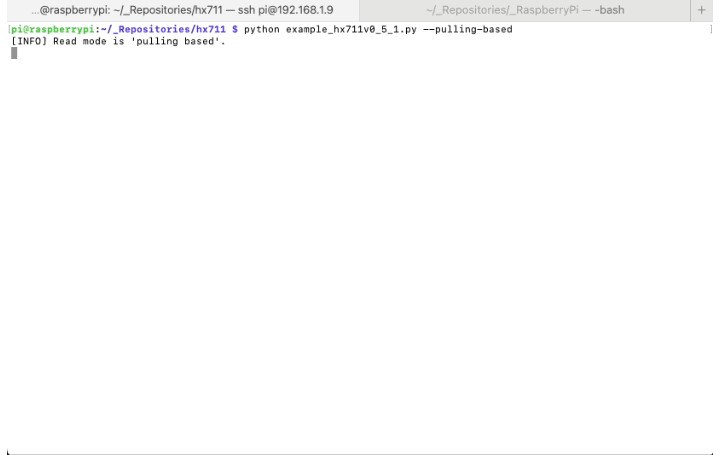

# HX711 for Raspberry Pi

This code is credited to [underdoeg](https://github.com/underdoeg/)'s gist [ HX711.py](https://gist.github.com/underdoeg/98a38b54f889fce2b237).

I've only made a few modifications on the way the captured bits are processed and to support Two's Complement, which it didn't.

I'm currently trying to improve this version. It's actually working, I'd use `hx711/core.py`.

## Warning: Possible random values

>  **Possible random values!**
>  Polling the bits from the HX711 is a time sensitive process as explained in the HX711 the datasheet. Raspberry runs on Linux which is not a good tool for time sensitive operations using the GPIO pins because tasks are prioritized by the Operative System which might delay a GPIO operation, causing the library to fail to poll the bits following the specified timing in the datasheet. It could also happen that the commands that poll the pins up and down run too fast for the HX711.
>
>  If there is a right way to precisely poll the bits with a Raspberry Pi (i.e. Linux OS) following the datasheet's timing specifications, which is in microseconds, which is a millionth of a second, then this code is probably not doing it in that right way and might return random values if other processes are running simultanously, delaying the GPIO operations, or if the processor is not busy with anything else at all, allowing the GPIO operations to happen too fast.
>
>  I know very little about OS architecture, but it seems to me that this two scenarios could happen. I'm not event a developer as you can see by how ugly the code and my commits are, so I'd think twice before trusting this code, haha.
>
>  I'm think that a better idea is to wire the HX711 to an MCU and the MCU to the Raspberry Pi. The MCU could poll a pin to trigger an event on the Raspberry Pi so that the Pi could retrieve the data from the MCU using 1-Wire or I2C, probably. Maybe a feature for the future.
>
>  So, at the risk of repeating myself, I do recommend using an Arduino or any MCU instead of a Raspberry Pi to poll bits from the HX711. and if you really need an Raspberry involved, then have the Arduino send the information to the Raspberry Pi vía I2C or 1-Wire. Hope this library helps, though.

## Table of contents

1. [Files description](#files-description)
2. [Instructions](#instructions)
3. [Running the tests](#running-the-tests)
4. [Measuring the sample rate](#measuring-the-sample-rate)
5. [Calibrating](#calibrating)
6. [Serving readings over the network](#serving-readings-over-the-network)
7. [About using the two channels of one breakout board](#about-using-the-two-channels-of-one-breakout-board)
8. [Changelog](#changelog)

## Files description

The library lives in the `hx711/` package. The utility scripts sit at the top level and import from it.

File descriptions:
- `hx711/core.py`: The main implementation. `read_word()` returns raw signed 24-bit values; `set_m()`/`set_c()` configure `read_weight()` to return `m * raw + c`.
- `example.py`: Example of how to use `hx711/core.py` to print calibrated weight readings.
- `example_emulator.py`: Example that runs `hx711/core.py` against the fake GPIO/HX711, so it works without a Raspberry Pi.
- `calibrate_sensor.py`: Interactive utility that measures known loads and reports the `m` and `c` values for `set_m()`/`set_c()`.
- `hx711_server.py`: HTTP server that publishes the latest calibrated reading as JSON.
- `example_client.py`: Example client that polls the server.
- `hx711/v0_5_1.py`: **Deprecated** — superseded by `hx711/core.py`. The previous version, which aimed at allowing 10 readings per second. Kept for backwards compatibility.
- `example_hx711v0_5_1.py`: Example of how to use the deprecated `hx711/v0_5_1.py`.
- `hx711/fake_gpio.py`, `hx711/fake_hx711.py`: Fake GPIO/HX711 used to run the library on a machine without a Raspberry Pi.
- `measure_sample_rate.py`: Utility that reports the achieved sample rate in Hz.
- `tests/`: Unit tests, run with `python -m pytest`.

## Instructions

### Core Version

No "setup.py" required if you're on Raspbian OS. I'm actually using the Lite Version without GUI to avoid processes messing up with the bit polling process.

```bash
clone git@github.com:tatobari/hx711py.git
python example.py
```

On a machine without a Raspberry Pi (or without `RPi.GPIO` installed) the library
automatically falls back to the fake GPIO/HX711, so the example still runs.

To install the package, use `pip install .`, or `pip install .[rpi]` to also pull
in `RPi.GPIO` on a Raspberry Pi.

### Running the tests

```bash
pip install -e .[dev]
python -m pytest
```

### Measuring the sample rate

```bash
python measure_sample_rate.py
```

### Calibrating

`calibrate_sensor.py` walks you through measuring one or more known loads and
fits `load = m * raw + c`:

```bash
python calibrate_sensor.py --unit kg
```

Enter a known load, let the scale settle, and press Enter to measure. Leave the
load blank to finish. With at least two different loads it prints the
calibration values and the lines to paste into your program:

```python
hx.set_m(m)
hx.set_c(c)
weight = hx.read_weight()
```

`read_weight()` returns `m * raw + c`, or `None` on a read timeout. Run
`python calibrate_sensor.py --help` for pin, sample-count, and gain options.

### Serving readings over the network

`hx711_server.py` reads the HX711 in a background thread and serves the latest
calibrated reading as JSON over HTTP:

```bash
python hx711_server.py --unit kg --m 0.000018 --c -2.5
```

Then poll it from another machine:

```bash
python example_client.py --url http://raspberrypi.local:8080/weight
```

`GET /weight` returns:

```json
{"ts": 1794601083.345, "weight": 12.47, "unit": "kg"}
```

`ts` is UTC epoch seconds. The endpoint has no authentication, so only expose it
on a trusted network. Run either script with `--help` for all options.

### Deprecated Version

`hx711/v0_5_1.py` is deprecated in favour of `hx711/core.py` and is kept for
backwards compatibility only. It supports interrupt-based and polling-based reads:

#### Interrupt based

```bash
clone git@github.com:tatobari/hx711py.git
python example_hx711v0_5_1.py
```



#### Polling based

```bash
clone git@github.com:tatobari/hx711py.git
python example_hx711v0_5_1.py --polling-based
```



## About using the two channels of one breakout board

This is a feature I, for some reason, decided to include in the original code.
In theory it allows using two loadcells at the same time, though channel B only
has a fixed gain, so the two channels differ in accuracy.

I haven't tested the use of two loadcells on the same breakout board at the same
time. It might not work.

Channel A has a selectable gain of 128 or 64, while channel B has a fixed gain of
32. Select them with `hx.set_channel_gain(...)`:

```python
hx.set_channel_gain(hx.CH_A_GAIN_128)  # Channel A, gain 128
hx.set_channel_gain(hx.CH_A_GAIN_64)   # Channel A, gain 64
hx.set_channel_gain(hx.CH_B_GAIN_32)   # Channel B, gain 32
```

`set_channel_gain()` raises `ValueError` for any other value.

This info was obtained from an HX711 datasheet located at:
https://cdn.sparkfun.com/datasheets/Sensors/ForceFlex/hx711_english.pdf

## Changelog

### 13/11/2026

- Restructured the library into the `hx711/` package; utility scripts at the top level import from it.
- `hx711/core.py` is now the main implementation; `hx711/v0_5_1.py` is deprecated.
- Removed the old simulated emulator; `hx711/fake_gpio.py` and `hx711/fake_hx711.py` remain for running without hardware.
- Added GPIO injection via `gpio_module=` and an `HX711.cleanup()` method.
- `set_channel_gain()` now validates its argument and raises `ValueError` for invalid values.
- Added `set_m()`, `set_c()`, and `read_weight()` for calibrated weight readings.
- Added `calibrate_sensor.py` to fit `m` and `c` from known loads.
- Added `hx711_server.py` and `example_client.py` for serving readings over HTTP.
- Added `measure_sample_rate.py` and a `pytest` test suite.
- `RPi.GPIO` is now an optional `rpi` extra, so the package installs off-Pi.
- README updated to match the current API.

### 03/03/2023

- Changed the filename of the new version to make a bit more sense (Sorry for not making a new branch for the new verison.).
- Added example file for v0.5.1.
- Added GIF examples of new library to README.md.
- Added example commands to README.md.
- **Tested v0.5.1 and working.**

### 28/02/2023

I'm only using my lunch time to commit changes in order to close all the HX711 environment on my mac because I need more processing power.

This version adds new methods to allow the use of interrupts as an alternative to polling.

### 25/02/2023

Funily enough and by pure accident, exactly two years after updating the README.md file with false promises, I'm back making a few changes.

My motivation to update this code is to improve the reading frequency.

### 25/02/2021

For the past years I haven't been able to maintain this library because I had too much workload. Now I'm back and I've been working on a few fixes and modifications to simplify this library, and I might be commiting the branch by mid-March. I will also publish it to PIP.
